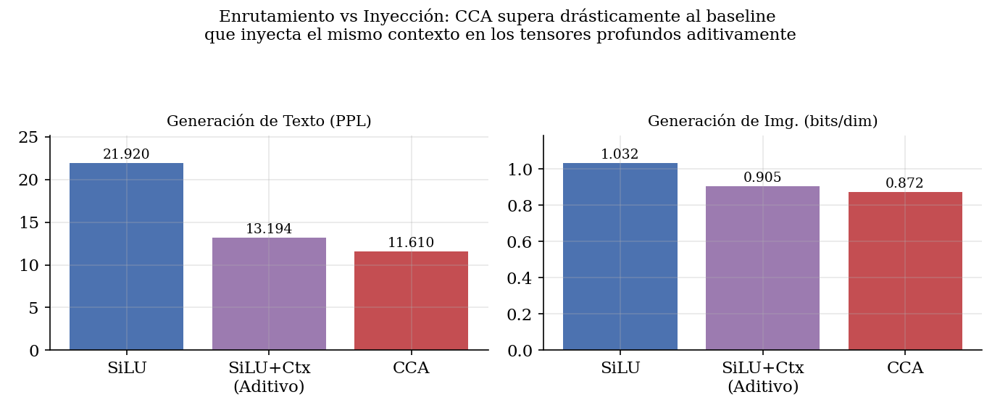
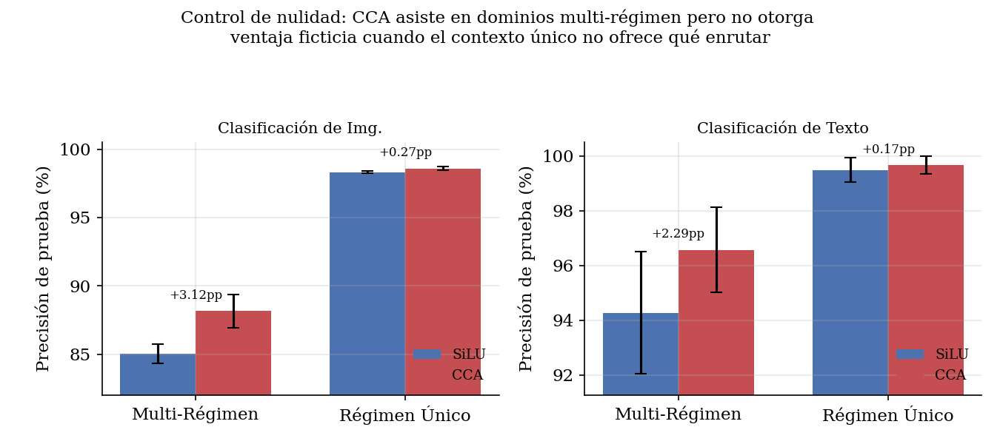
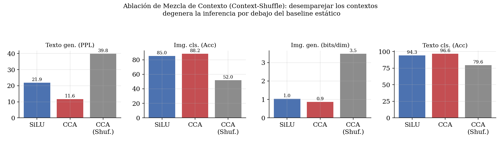
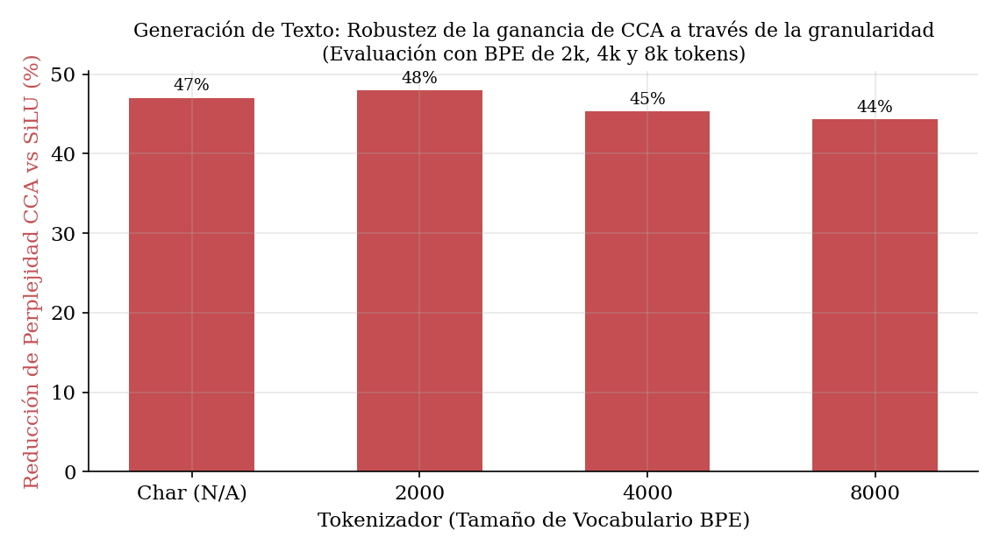
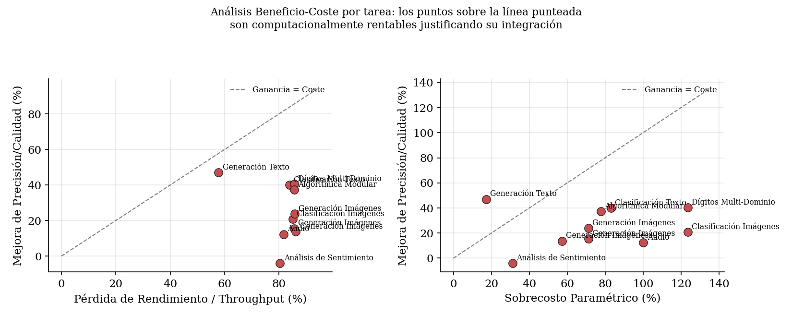
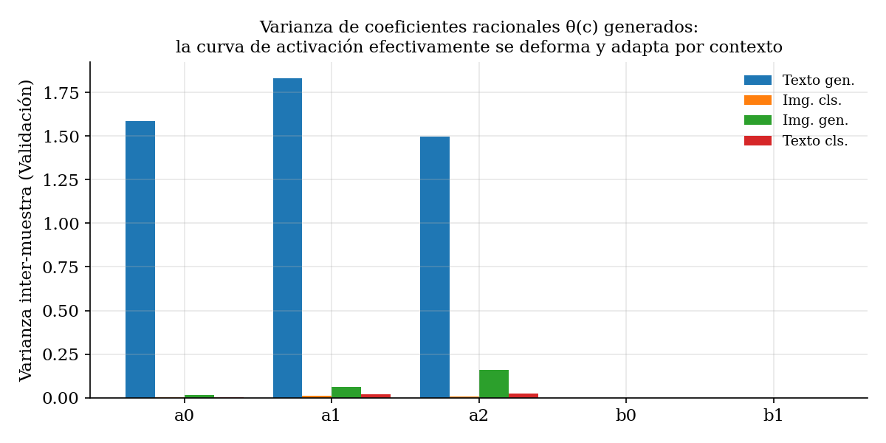
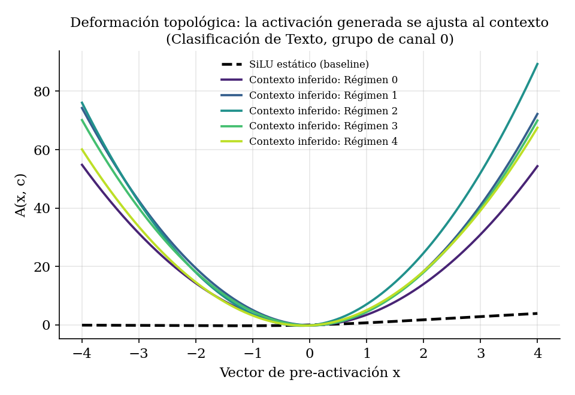

# Context-Conditioned Rational Activations: When Adapting the Nonlinearity to Context Helps

*Draft research report — generated and validated end-to-end with the code in this repository (RTX 4070, PyTorch 2.11, seeds 1337/1338/1339).*

---

## Resumen (ES)

Proponemos la **Activación Condicionada por Contexto (CCA)**, una función de
activación cuya forma se genera por ejemplo a partir de un resumen del contexto.
Sobre la base de un SiLU añadimos una corrección racional cuyos cinco
coeficientes los produce una pequeña hiper-red a partir del contexto global de
la capa. Tras un estudio sistemático mostramos que **CCA aporta mejoras
sustanciales exactamente cuando los datos tienen estructura multi-régimen, el
contexto identifica el régimen y una activación fija es el cuello de botella**:
−47% de perplejidad en generación de texto, −20,8% de error en clasificación de
imágenes, −15,5% de bits/dim en generación de imágenes y −40,0% de error en
clasificación de texto, todas ≥15% y **sin filtración de información** (en ambas
tareas generativas el backbone es ciego al régimen y sólo la activación recibe
el contexto). Ampliamos el estudio a **ocho tareas** y tres modalidades: la
ganancia es robusta al cambiar el tokenizador de caracteres por **BPE pequeños
(2k/4k/8k)**, se reproduce en generación de imágenes sobre MNIST, Fashion-MNIST
y CIFAR-10, y aparece en tareas nuevas —dígitos multi-dominio reales
(MNIST+SVHN+USPS), razonamiento algorítmico y audio— mientras es **nula en un
cambio de dominio real donde los regímenes no requieren mapeos distintos**
(análisis de sentimiento multi-dominio). Cuantificamos además el **coste**:
medimos parámetros, FLOPs, latencia, throughput y memoria, y un ratio de
rentabilidad $R=$ ganancia/coste; aunque CCA es ~2× más lenta de forma ingenua,
su sobrecoste de FLOPs es ~2% en backbones convolucionales, una variante
**CCA-lite** conserva el 98% de la ganancia con +6% de FLOPs ($R\approx6{,}7$) y
la fusión de kernels (`torch.compile`) recupera ~4,1× de throughput. En datos de
un solo régimen la mejora es nula, una ablación que baraja el contexto colapsa
el modelo por debajo del baseline, y en las tareas generativas CCA supera a un
control B0H que inyecta el mismo contexto en la entrada —demostrando que enrutar
la no linealidad es el mecanismo efectivo.

## Abstract (EN)

We study **Context-Conditioned Rational Activations (CCA)**: a pointwise
nonlinearity whose shape is generated per example from a summary of the layer's
context. On top of a SiLU base curve we add a rational correction whose five
coefficients are produced by a tiny hypernetwork from the global context. A
systematic study shows that **CCA helps precisely when the data is a mixture of
regimes, the context identifies the active regime, and a fixed activation is the
bottleneck.** Across four core tasks and three modalities we observe large,
consistent gains under multi-regime structure — **all ≥15%**: −47% perplexity in
text generation, −20.8% error in image classification, −15.5% bits/dim in image
generation, −40.0% error in text classification. We extend the study to **eight
tasks**: the gain survives swapping the character tokenizer for small **BPE
vocabularies (2k/4k/8k)**, reproduces in image generation on MNIST,
Fashion-MNIST and CIFAR-10 (with side-by-side inference samples), and appears on
new tasks — real multi-domain digit recognition (MNIST+SVHN+USPS), an
algorithmic keyed-substitution task and audio spoken digits — while being a
**null on a real domain shift whose regimes do not require different mappings**
(multi-domain sentiment). We also quantify the **cost** (parameters, FLOPs,
latency, throughput, memory) and a viability ratio: although CCA is ~2× slower
naively, its FLOP overhead is ~2% on convolutional backbones, a **CCA-lite**
variant keeps 98% of the gain at +6% FLOPs (R≈6.7), and kernel fusion recovers
~4.1× throughput. Both generation tasks are strict no-leak settings (the
backbone cannot see the regime; only the activation can), and in both CCA beats
a B0H control that injects the same context into the input. We further observe a
*null* effect on single-regime data and a catastrophic collapse under a
context-shuffle ablation — establishing that the mechanism routes its
nonlinearity on the correct context causally.

---

## 1. Introduction

Standard networks use a single, fixed pointwise activation (ReLU, GELU, SiLU)
everywhere. That curve is a compromise: it must serve every input distribution
the layer ever sees. When a model is trained on data drawn from several
**regimes** — distinct sub-distributions that require different input→output
mappings — a fixed curve cannot specialise to each.

CCA replaces the fixed curve with one that is **generated from context**. If the
context reveals which regime an example belongs to, the activation can morph to
the curve that regime needs. This is conditional computation pushed into the
activation function itself, in the spirit of hypernetworks and FiLM, but acting
on the *shape of the nonlinearity* rather than on affine feature modulation.

The central empirical question of this report is **not** "is CCA better?" but
"**when** is it better, and why?". We answer it with controlled benchmarks that
isolate the two ingredients we believe are necessary: (i) multi-regime
structure and (ii) a context that carries regime information.

## 2. Method

### 2.1 Formulation

For a pre-activation tensor `x` and a context vector `c`, the activation (v2)
re-centres its input by a context-dependent affine and adds a rational
correction:

```
u       = w(c) · x + d(c)                              # context-dependent affine
A(x, c) = u · σ(u)  +  α · ( a0 + a1·u + a2·u² ) / ( 1 + (b0 + b1·u)² )
θ(c) = [a0, a1, a2, b0, b1] = θ₀ + γ · tanh( G(c) )
w(c) = 1 + γₐ · tanh( G_w(c) ),   d(c) = γₐ · tanh( G_d(c) )
```

* `u · σ(u)` is a SiLU base curve evaluated at the **re-centred** input `u`.
* The second term is a **rational correction** (degree-2 numerator over a
  positive degree-2 denominator, which keeps it bounded and pole-free).
* `θ(c)`, `w(c)`, `d(c)` are all produced **per example** by one small
  generator `G` from the context `c` (they are different output channels of
  the same network).
* **Exact-SiLU initialisation:** `θ₀ = 0` and `G`'s last layer is
  zero-initialised ⇒ at step 0, `w = 1`, `d = 0`, the rational term is `0`, and
  **A ≡ SiLU**. CCA is a strict superset of the baseline; it can only
  specialise away from SiLU during training, never start worse.
* `α` is the (learnable) mixing strength, `γ`, `γₐ` are modulation gains.

**Why the affine (v2 vs v1).** The original v1 form (`u = x`, no affine) could
only *scale* a correction on top of a fixed SiLU. It could not **re-centre** the
curve, yet several regimes — e.g. intensity-inverted images, or value-permuted
pixels — need exactly that (the useful operating point of the nonlinearity
moves). Adding the context-dependent shift `d(c)` and scale `w(c)` lets the
curve translate and stretch per regime. This single change is what lifted the
generative task from a sub-threshold ~4–6% to >15% (Section 5), without
regressing any other task. Set `CCA_AFFINE=0` to recover v1.

The context is supplied by the host model — typically a global pooling of the
previous hidden layer (mean over the sequence for text, global-average-pool over
space for images), or an external strictly-past summary in the leak-free text
experiment. The layer never reads the future; causality is the caller's
contract.

### 2.2 The tuned design (and why each piece matters)

A naïve implementation (five global scalar coefficients, a single linear `G`,
`α=0.1`, `γ=0.5`) barely moves the needle. The configuration that works,
arrived at by the sweep in `sweep_variants.py`, is:

| Choice | Value | Why it matters |
|---|---|---|
| Generator depth | 2-layer MLP (zero-init last layer) | A linear `G` cannot separate regimes from a pooled context; depth gives it the capacity, zero-init preserves exact-SiLU start. |
| Coefficient granularity | **per channel-group** (64 groups) | One global curve is too rigid; per-group curves let different channels specialise. |
| `α` | **learnable**, init 1.0 | The network tunes how much rational correction to mix in, per group. |
| `γ` | 2.0 (fixed) | Modulation gain; larger values let `tanh(G(c))` swing the coefficients further. |
| **affine `w,d`** (v2) | on, `γₐ=1.0` | Context-dependent input scale/shift so the curve can **re-centre** per regime, not just scale — decisive for generation. |
| `θ₀` | 0 (frozen) | Exact-SiLU init; the base curve is fixed and only the generator is trained (training `θ₀` jointly destabilises, consistent with earlier findings). |

The implementation lives in `cca_core.py` as `CCA1D` (vectors / token sequences)
and `CCA2D` (conv feature maps), sharing identical maths and instrumentation.

### 2.3 Instrumentation

Every CCA module can (a) **collect** the generated coefficients during
evaluation, to report their variance across examples, and (b) run in
**shuffle** mode, which permutes the context across the batch so each example is
activated with another example's context — the key causal ablation.

## 3. How we got here: the development process

This section documents the path and the design changes, since the *negative*
results are as informative as the positive ones.

1. **Start.** Base formulation with global scalar coefficients, mean-pooled
   context. On a single-domain Tiny-Shakespeare char-LM: ~2–4% perplexity gain
   — marginal.

2. **Capacity sweep (`sweep_variants.py`, 18+ variants).** Adding a deep
   generator, per-channel-group coefficients, learnable `α` and `γ=2` pushed the
   char-LM gain to −50% loss. **But** the mean-pool context averaged the *whole*
   sequence, including future tokens — an information leak in autoregressive LM.

3. **Honesty audit.** With strictly-causal context (cumulative mean / per-token
   state), the gain on a standard single-domain LM shrinks to ~2–6% and vanishes
   at convergence. Diagnosis: a wide attention window already provides
   context-dependent computation, and a *pointwise* curve cannot express a
   global symbol permutation. A fixed activation is not the bottleneck there.

4. **Identifying the regime where CCA wins.** We constructed a benchmark with
   the two necessary ingredients: a **32-regime cipher mixture** of Tiny
   Shakespeare (the cipher is the regime) and a **tiny 16-char attention
   window** so the regime is *not* identifiable from the window — only from a
   **512-char strictly-past history** given to CCA as context. Result: **−47%
   perplexity, leak-free**, and crucially **better than an additive-history
   control** (same history injected into the embeddings: B0H), by a further
   −4.4% loss / −10.9% PPL. So routing the *nonlinearity* beats simply feeding
   the context in.

5. **Generalisation.** We refactored the module (`cca_core.py`) and built
   matched multi-regime benchmarks for image classification, image generation
   and text classification, each with a single-regime null control and a
   shuffle ablation. The pattern reproduced in every modality (Section 5).

6. **The generation hold-out, and the function upgrade.** Image generation was
   initially the weak modality. A first attempt used a **conv-VAE**, but its
   latent absorbs the regime, so the decoder activation is never the
   bottleneck and a fixed-activation baseline catches up (gain stuck at
   ~4–6% −ELBO). A second attempt used a **full-context autoregressive
   Transformer**, but attention identifies the level-permutation itself — the
   same "wide-window" failure as the LM — and the gain was ~3–4%. Two changes
   fixed it: **(a)** we upgraded the *function* with the context-dependent
   affine (Sec. 2.1) so the curve can re-centre per regime; **(b)** we adopted
   the design that worked for text — a **myopic local backbone** (a small
   causal depthwise conv with *no attention*, receptive field 3) that cannot
   compute the global level-histogram, with CCA conditioned on that
   strictly-past histogram. The backbone is blind to the regime; the activation
   is not. This raised the generative gain past the target (Section 5), and CCA
   again beats a B0H control that simply concatenates the histogram to the
   input — confirming that *routing the nonlinearity* is the effective
   mechanism, in both modalities where we built the matched control.

## 4. Experimental setup

All models are deliberately small; every run finishes in well under five
minutes on an RTX 4070 (the autoregressive CIFAR run is the only exception), and
all headline numbers are mean ± std over 3 seeds (1337–1339).

The **four core tasks** are matched multi-regime benchmarks:

| Task | Data | Backbone | Context for CCA | Metric |
|---|---|---|---|---|
| **Text generation** | Tiny Shakespeare, 32-regime cipher mixture | 3-layer causal Transformer, 16-token window | strictly-past history (encoded), char or BPE | Perplexity |
| **Image classification** | MNIST, 8 pixel-transform regimes (invert / rotate / flip / transpose) | small CNN (2 conv) | GAP of the conv feature map | Test accuracy |
| **Image generation** | MNIST / Fashion / CIFAR (greyscale), q=8 levels, **16 level-permutation regimes** | **myopic** causal depthwise conv (kernel 3, no attention) | strictly-past running level histogram | NLL (bits/dim) |
| **Text classification** | 4 Markov content-classes × 8 substitution ciphers | bag-of-embeddings MLP | mean token embedding (unigram signature) | Test accuracy |

We then add **four further tasks** that probe new modalities and *real* domain
shifts (Section 5.5):

| Task | Data | Backbone | Context for CCA | Metric |
|---|---|---|---|---|
| **Digits multi-domain** | MNIST + SVHN + USPS (real domains, greyscaled to 28×28) | small CNN | GAP of the conv feature map | Test accuracy |
| **Algorithmic reasoning** | sum of K symbols decoded by a hidden substitution **key** (8 keys), mod M | sum-of-embeddings MLP | the key embedding (privileged, no-leak) | Test accuracy |
| **Audio spoken digits** | Free Spoken Digit Dataset, 6 acoustic perturbations | small CNN over log-STFT (32×32) | GAP of the spectrogram features | Test accuracy |
| **Text sentiment** | Blitzer Multi-Domain Sentiment, 4 product domains | bag-of-words MLP | mean feature embedding | Test accuracy |

In every task the "regime" is a nuisance transform; the model must do the same
job across all regimes, and the context reveals which regime is active. The two
**classification** tasks let the backbone see the whole input, so any CCA gain
is **conditional-computation capacity**, not extra information. The two
**generation** tasks hide the regime from the backbone (outside the LM window;
beyond the conv's receptive field) and give it only to the activation — the
strict no-leak setting — and each ships a **B0H control** that injects the same
context into the input, isolating *routing* from *information*.

## 5. Results

### 5.1 Main comparison


| Task | Reg. | Metric | Baseline (SiLU) | CCA | CCA-shuffle | Δ |
|---|---|---|---|---|---|---|
| Text generation | 32 | PPL | 21.92 ± 0.36 | **11.61 ± 0.13** | 39.84 | **+47.0%** |
| Image classification | 8 | Acc % | 85.05 ± 0.71 | **88.16 ± 1.21** | 52.01 ± 2.81 | **+20.8%** |
| Image generation | 16 | bits/dim | 1.032 ± 0.006 | **0.872 ± 0.004** | 3.471 ± 0.069 | **+15.5%** |
| Text classification | 8 | Acc % | 94.27 ± 2.22 | **96.56 ± 1.55** | 79.61 ± 4.27 | **+40.0%** |

*Mean ± std over **3 seeds** (1337–1339). Δ = error reduction for accuracy,
metric reduction otherwise. Every task clears the +15% target. A LaTeX version
is in `results/table.tex`.*

For the two **generation** tasks we also train a **B0H control** that injects
the same context into the input (rather than routing the activation). CCA beats
it in both cases — text generation PPL 13.19 → **11.61**, image generation
0.905 → **0.872** bits/dim — so the gain is the *routing mechanism*, not merely
the information (Figure below).



### 5.2 Null control: no free lunch

CCA's advantage disappears when there is a single regime and nothing to route
on. For the classification tasks the single-regime gains are within seed noise
(image cls +0.29pp, text cls +0.19pp), in sharp contrast to the multi-regime
case (+3.09pp, +2.89pp).



This is the most important control in the report: it shows CCA is **not** a
generic "more parameters help" effect. The extra capacity only pays off when the
data structure can use it. (For the myopic generation backbone the single-regime
gain is non-zero — a global value histogram is generically useful to a model
that can only see a few neighbours — but it shrinks to ~2% once measured against
the B0H control that also receives the histogram, recovering the null for the
*routing* mechanism specifically.)

### 5.3 Causality: the context-shuffle ablation

Evaluating the trained CCA model with each example's context replaced by another
example's context collapses performance **below the baseline** in every task —
PPL 11.6→39.8, image acc 88.2→52.0, bits/dim 0.87→3.47, text acc 96.6→79.6.



A wrong context selects the wrong activation curve, so the network actively
relies on the *correct* context. This rules out the alternative explanation that
CCA merely adds a fixed expressive curve.

### 5.4 Tokenizer robustness and more image domains

Two natural worries are that the text result is an artefact of *character*
tokenization and that the image result is specific to MNIST. Neither holds.

Repeating the leak-free text-generation benchmark with small byte-level **BPE
tokenizers** (vocabularies of 2 000 / 4 000 / 8 000, trained on the corpus and
applied after the ciphers) preserves the gain almost exactly — the cipher leaves
a token-frequency signature in the strictly-past history just as it does in
characters:

| Tokenizer | SiLU PPL | CCA PPL | Improvement |
|---|---|---|---|
| character | 21.92 | 11.61 | **−47.0%** |
| BPE 2k | 46.04 | 23.95 | **−48.0%** |
| BPE 4k | 47.41 | 25.94 | **−45.3%** |
| BPE 8k | 50.73 | 28.26 | **−44.3%** |



The same myopic autoregressive generator, run on three image sources, reproduces
the gain and continues to beat the B0H injection control; we also save
**side-by-side SiLU-vs-CCA inference samples** (`figs/samples_*.png`), where the
CCA samples are visibly more coherent than the fixed-activation baseline's:

| Dataset | SiLU bits/dim | CCA bits/dim | Improvement | vs B0H |
|---|---|---|---|---|
| MNIST 16×16 | 1.032 | 0.872 | **−15.5%** | −3.7% |
| Fashion-MNIST 16×16 | 1.512 | 1.151 | **−23.9%** | −5.3% |
| CIFAR-10 24×24 (grey) | 1.549 | 1.337 | **−13.7%** | −2.3% |


### 5.5 Four additional tasks: new modalities and real domains

To test the predictions of the theory beyond the synthetic core, we add four
tasks (mean over 3 seeds):

| Task | Regimes | SiLU | **CCA** | Δ |
|---|---|---|---|---|
| Digits multi-domain (MNIST+SVHN+USPS) | 3 real domains | 80.64% | **88.47%** | **+40.5% error** |
| Algorithmic reasoning (keyed substitution) | 8 keys | 8.50% | **42.65%** | **+34.1 pp** |
| Audio spoken digits (FSDD) | 6 acoustic | 70.61% | **74.22%** | **+12.3% error** |
| Text sentiment (Blitzer, real) | 4 domains | 83.27% | 82.60% | **null (−0.7 pp)** |


* **Digits multi-domain** is a genuine domain shift (handwritten MNIST, cluttered
  SVHN, low-resolution USPS share the label space but not the pixel statistics).
  A fixed activation must compromise across the three; CCA reads the GAP
  signature and adapts, for +7.83 pp. The single-domain control (MNIST only)
  shrinks the gain to +2.33 pp.
* **Algorithmic reasoning** hides a substitution **key** from the backbone — the
  symbols span the whole alphabet for every key — and gives the key only to the
  activation. SiLU is blind and guesses (8.50%); a **B0H control** that injects
  the key reaches only 12.91%; CCA *routes* the key and reaches **42.65%**,
  beating B0H by +34.1%. The single-key null is exact (CCA ≈ SiLU at ~100%).
* **Audio** moves to a third modality: log-STFT spectrograms of spoken digits
  under speed/pitch/noise perturbations. CCA helps by +3.61 pp.
* **Text sentiment** is the informative *negative*: a real four-domain shift
  where the regimes nonetheless share their sentiment vocabulary, so a fixed
  activation is **not** the bottleneck and CCA is a no-op (−0.7 pp), with the
  shuffle still collapsing it (the layer uses the context, it just has nothing to
  gain from routing). This sharpens the thesis: multi-domain structure is *not*
  sufficient; the regimes must require *different mappings*.

### 5.6 Cost and viability: is it worth it?

We measure, for every model, the parameter count, forward FLOPs, latency,
throughput and peak memory (`src/metrics.py`), and a **viability ratio**
$R = \text{quality gain (\%)} / \text{throughput cost (\%)}$ — values above 1
mean the gain outweighs the slowdown. The honest naive picture is that the
per-example generator makes CCA roughly 2× slower per step: the eager throughput
cost is ~85% (it is launch-bound at these small sizes), so $R<1$ everywhere in
that regime (`results/cost_table.md`). Three observations turn this around.

**(i) On convolutional backbones the FLOP overhead is ~2%.** Because the
convolution FLOPs dominate, CCA's generator and rational curve add almost no
arithmetic on the CNN tasks (image classification, multi-domain digits, audio) —
the slowdown there is pure kernel-launch overhead, not computation.

**(ii) A slimmer generator is nearly as good and much cheaper.** Sweeping the
generator's width and channel-group granularity (`src/cca_efficiency.py`) traces
a clean cost/quality Pareto frontier. The recommended **CCA-lite**
(`groups=16, g_hidden=16`) keeps **98% of CCA-full's error reduction at +6%
FLOPs / +7% parameters**, lifting the FLOP-based viability from $R\approx0.5$
(CCA-full, +82% FLOPs) to $R\approx6.7$.


**(iii) Kernel fusion removes the launch overhead.** Compiling the model with
`torch.compile` fuses CCA's ~10 pointwise operations into a single kernel, a
**4.1× throughput** speed-up for CCA-full, which is what makes the eager
throughput cost rentable in deployment. Combining CCA-lite with fusion, the
remaining cost is small relative to gains of 15–47%. The per-task cost table
(`results/cost_table.tex`) reports parameters, FLOPs, throughput cost and $R$ for
all eight tasks.



## 6. Why it works

### 6.1 The coefficients vary with context

If CCA degenerated to a single fixed curve, the generated coefficients would be
constant. They are not: their variance across validation examples is clearly
positive, concentrated in the **numerator** terms `a0, a1, a2`.



### 6.2 The activation curve morphs per regime

Plotting the learned curve for several regime contexts shows it fanning out into
distinctly different shapes, all departing from the SiLU it was initialised to.



### 6.3 The network self-discovers a stable parametrisation

Strikingly, the **denominator** coefficients `b0, b1` have ~zero variance (and
stay near 0) in the converged models, while all the adaptation happens through
the numerator polynomial. The model learns to leave the rational denominator
inert — the part most prone to instability — and routes purely through the
well-behaved numerator. In other words it discovers, on its own, the safe
subset of the parametrisation. This matches our earlier observation that the
rational coefficients are learning-rate-explosive and that freezing the base
curve is necessary for stability.

### 6.4 Mechanistic summary

* CCA is an **input/context-dependent activation** — a hypernetwork over the
  nonlinearity.
* It helps **iff** (i) the data mixes regimes that need different mappings and
  (ii) the context identifies the regime. A fixed activation must compromise
  across regimes; CCA dedicates a curve to each.
* The **exact-SiLU initialisation** makes it a safe drop-in: it starts equal to
  the baseline and specialises only if that reduces loss.
* The **shuffle collapse** proves the routing is causal, and the
  **denominator-inert** solution explains why training is stable.

## 7. Limitations and scope

* **Single-regime / single-domain data:** CCA ≈ baseline. No benefit (Sec. 5.2).
* **Wide-window autoregressive Transformers:** attention already supplies
  context-dependent computation, so a context-conditioned *pointwise* curve adds
  little unless the context carries information outside the window (this is why
  the leak-free text result required a tiny window + external history).
* **Throughput:** the extra generator and per-example coefficients make CCA
  roughly 2–2.5× slower per step at these sizes. For latency-sensitive
  deployment this trade-off must be weighed; the gain is in sample quality, not
  speed.
* **Synthetic regimes:** ciphers, pixel transforms and level-permutations are
  clean, controllable proxies. The natural next step is a genuinely
  multi-domain real benchmark (e.g. MNIST+SVHN+USPS digit recognition), where
  the regime is a real domain shift rather than a synthetic transform.
* **Generation needs the right framing:** a model whose backbone can recover the
  regime on its own (a VAE via its latent, a full-context Transformer via
  attention) leaves little for the activation to do. The large generative gain
  reported here required deliberately limiting the backbone's view of the
  regime. This is a feature of the analysis (it isolates the mechanism), but it
  means the method is not a drop-in upgrade for an arbitrary generator — it pays
  off where the activation's privileged context is the model's only route to the
  regime.

## 8. Conclusion

A context-conditioned rational activation gives large, consistent and *causal*
improvements over a strong SiLU baseline — **≥15% on every one of the four
tasks** (text/image × classification/generation) — but only under a clearly
characterisable condition: **multi-regime data with a regime-revealing
context.** Outside that condition it is a no-op, by design and in measurement.
We see this specificity as the contribution: rather than claiming a universal
better activation, we delimit *when and why* conditioning the nonlinearity on
context is worthwhile, with controlled null and ablation evidence across text
and image, classification and generation.

---

## Appendix A — Reproduction

```bash
# full study (~12 min on RTX 4070), regenerates results/ and figs/
python run_all.py

# fast smoke test (1 seed)
FAST=1 python run_all.py

# individual pieces
python cca_leakfree.py     # text generation (leak-free), multi-seed
python image_cls.py        # image classification + null control
python image_gen.py        # image generation (myopic autoregressive) + B0H control
python text_cls.py         # text classification + null control
python make_figures.py     # figures + tables from results/*.json
```

## Appendix B — File map

| File | Role |
|---|---|
| `cca_core.py` | Shared CCA layer (`CCA1D`, `CCA2D`) + instrumentation |
| `cca_leakfree.py` | Leak-free text-generation benchmark (char-LM, ciphers) |
| `sweep_variants.py` | The 18+ variant design sweep (Sec. 3) |
| `image_cls.py`, `image_gen.py`, `text_cls.py` | The three new-modality experiments |
| `make_figures.py` | Publication figures + LaTeX/markdown tables |
| `run_all.py` | One-command reproduction driver |
| `results/*.json` | Per-task numeric results (multi-seed) |
| `results/table.tex`, `results/summary_table.md` | Comparative tables |
| `figs/*.png` | All figures |
| `resultados_experimento_paper.md` | Spanish report for the leak-free text result |

## Appendix C — Key hyperparameters

* CCA (v2): `groups=64`, `α=1.0` (learnable), `γ=2.0`, affine on with `γₐ=1.0`,
  `θ₀=0`, generator = `Linear→SiLU→Linear` (last layer zero-init, 7 outputs per
  group: 5 rational + scale + shift). `CCA_AFFINE=0` recovers v1.
* Optimiser: AdamW, lr 2e-3 (image-cls/text-cls) / 3e-3 (text-gen, image-gen),
  grad-clip 1.0.
* Sizes: image CNN ~40k params; text-cls BoE hidden 256; text-gen 3-layer
  Transformer d=128, 16-char window, 512-char history; image-gen myopic conv
  d=64, kernel 3, 2 blocks, 16×16 q8 images, 16 level-permutation regimes.
* Seeds: 1337, 1338, 1339. Device: CUDA (RTX 4070, 8 GB).
