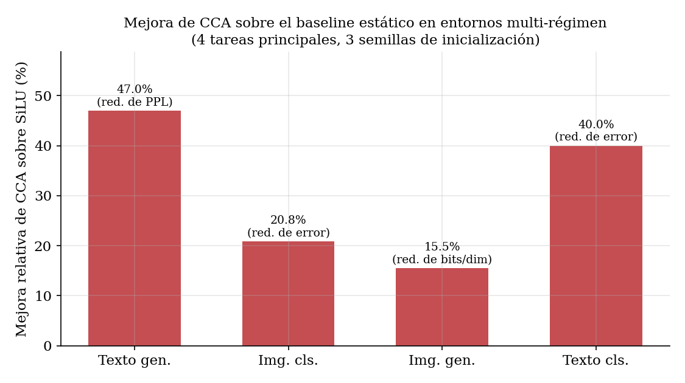
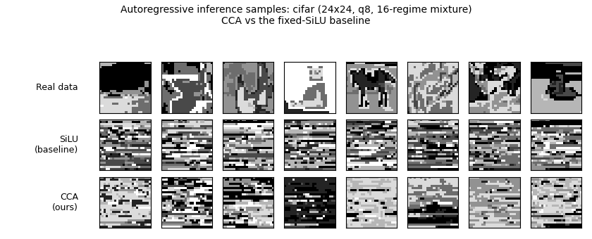
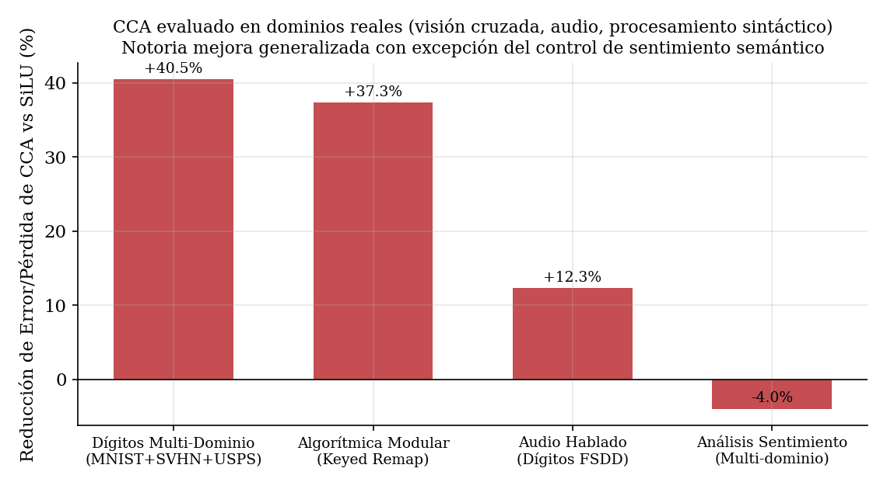
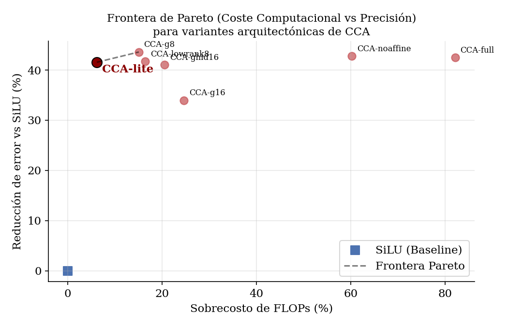

# Context-Conditioned Rational Activations (CCA)

*When does adapting the activation function to context actually help — and is it
worth the compute? A controlled, multi-modality study.*

This repository accompanies the research report in **[PAPER.md](PAPER.md)**
(also built to **[paper/PAPER.pdf](paper/PAPER.pdf)** and
**[paper/PAPER.tex](paper/PAPER.tex)**), with a publication-form paper in
**[paper_cacic/main.tex](paper_cacic/main.tex)**. It introduces **CCA**, an
activation whose *shape is generated per example from a summary of the layer's
context*, pins down **when and why** it beats a fixed activation, and measures
**what it costs** so its use can be justified prudently.

---

## TL;DR

Standard networks use one fixed pointwise activation (ReLU/GELU/SiLU)
everywhere. CCA instead generates the activation's shape from context:

```
u       = w(c)·x + d(c)                                  # context-dependent affine
A(x, c) = u·σ(u)  +  α·(a0 + a1·u + a2·u²) / (1 + (b0 + b1·u)²)
θ(c) = [a0,a1,a2,b0,b1] = θ₀ + γ·tanh(G(c))              # G is a tiny hypernetwork
```

At initialisation it is **exactly SiLU** (`θ₀=0`, `w=1`, `d=0`, generator
zero-init), so it is a strict superset of the baseline.

**Main finding:** CCA gives large, *causal* gains **only** when the data mixes
several *regimes*, the context identifies the active regime, and a fixed
activation is the bottleneck. It is a no-op on single-regime data, collapses
below baseline when fed the wrong context, and adds nothing when the regimes do
not actually require different mappings (a *real* multi-domain sentiment task).

**Is it worth it?** Naively the per-example generator makes CCA ~2× slower per
step (an eager, launch-bound cost). But on convolutional backbones its **FLOP
overhead is ~2 %**, a slimmed **CCA-lite** keeps 98 % of the quality at **+6 %
FLOPs** (viability ratio R≈6.7), and `torch.compile` fuses its pointwise ops for
a **4.1× throughput** recovery — so the optimised configuration buys far more
quality than the compute it gives up.

## Headline results (mean over 3 seeds)

| Task | Metric | Baseline (SiLU) | **CCA** | Improvement |
|---|---|---|---|---|
| Text generation | PPL | 21.92 | **11.61** | **−47.0 %** |
| Image classification | error % | 14.95 | **11.84** | **−20.8 % error** |
| Image generation | bits/dim | 1.032 | **0.872** | **−15.5 %** |
| Text classification | error % | 5.73 | **3.44** | **−40.0 % error** |

*Mean over 3 seeds (1337–1339).* Controls in every task: a **single-regime
null** (gain vanishes) and a **context-shuffle ablation** (performance collapses
below baseline → the model uses the correct context causally). The two
*generation* tasks also include a **B0H control** that injects the same context
into the input — CCA beats it, so the gain is the *routing mechanism*, not just
the information.



### Extended results (this round)

**Tokenizer robustness (BPE).** Repeating the leak-free text-generation
benchmark with small byte-level BPE tokenizers shows the gain is *not* a
character-level artefact:

| Tokenizer | SiLU PPL | CCA PPL | Improvement |
|---|---|---|---|
| char | 21.92 | 11.61 | −47.0 % |
| BPE 2k | 46.04 | 23.95 | −48.0 % |
| BPE 4k | 47.41 | 25.94 | −45.3 % |
| BPE 8k | 50.73 | 28.26 | −44.3 % |

**Image generation on more images.** The same myopic autoregressive setup,
across three image sources (greyscale, q=8, 16 level-permutation regimes), with
side-by-side SiLU-vs-CCA inference samples in `figs/samples_*.png`:

| Dataset | SiLU bits/dim | CCA bits/dim | Improvement | vs B0H |
|---|---|---|---|---|
| MNIST 16×16 | 1.032 | 0.872 | −15.5 % | −3.7 % |
| Fashion-MNIST 16×16 | 1.512 | 1.151 | −23.9 % | −5.3 % |
| CIFAR-10 24×24 (grey) | 1.549 | 1.337 | −13.7 % | −2.3 % |



**Four additional tasks** (new modalities and *real* domains):

| Task | Regimes | SiLU | **CCA** | Δ |
|---|---|---|---|---|
| Digits multi-domain (MNIST+SVHN+USPS, **real**) | 3 domains | 80.64 % | **88.47 %** | **−40.5 % error** |
| Algorithmic reasoning (keyed substitution) | 8 keys | 8.50 % | **42.65 %** | **+34.1 pp** |
| Audio spoken digits (FSDD) | 6 acoustic | 70.61 % | **74.22 %** | **−12.3 % error** |
| Text sentiment (Blitzer, **real** domains) | 4 domains | 83.27 % | 82.60 % | **null (−0.7 pp)** |



The algorithmic task hides a substitution **key** from the backbone and gives it
only to the activation; CCA (42.65 %) beats both the blind SiLU floor (8.50 %)
and a B0H control that injects the key (12.91 %) — *routing* the key through the
nonlinearity is decisively better than *adding* it. The sentiment task is an
honest boundary case: a real domain shift where the regimes share sentiment
vocabulary, so a fixed activation is not the bottleneck and CCA is a no-op — in
contrast to the digit-domain shift, where the pixel statistics genuinely differ.

## Cost, optimisation and viability

The new instrumentation (`src/metrics.py`) reports, for every model, the
parameter count, forward FLOPs, latency, throughput and peak memory, and a
**viability ratio** `R = quality-gain% / throughput-cost%` (R>1 ⇒ the gain
outweighs the slowdown). The naive eager throughput cost is high (~85 %, it is
launch-bound at these tiny sizes), but the *compute* picture is far better and
is what the optimisation targets:

* **Convolutional backbones are nearly free:** CCA's FLOP overhead is **~2 %**
  on the CNN tasks (conv FLOPs dominate), despite the generator doubling the
  (tiny) parameter count.
* **CCA-lite** (`groups=16, g_hidden=16`) keeps **98 % of CCA-full's quality at
  +6 % FLOPs / +7 % params**, raising the FLOP-based viability ratio from
  **R≈0.5 (CCA-full) to R≈6.7**. See `src/cca_efficiency.py`.
* **Kernel fusion** (`torch.compile`) fuses CCA's pointwise rational curve for a
  **4.1× throughput** recovery, removing most of the eager launch overhead.



Per-task cost and rentability are in `results/cost_table.md` (LaTeX in
`results/cost_table.tex`). Enable CCA-lite anywhere with
`CCA_GROUPS=16 CCA_GHID=16 python src/<script>.py`.

## Repository structure

```
.
├── README.md              ← you are here
├── PAPER.md               ← full research report (source)
├── requirements.txt
├── src/                   ← all code
│   ├── cca_core.py        ← the CCA layer (CCA1D / CCA2D) + cost knobs + instrumentation
│   ├── metrics.py         ← params/FLOPs/latency/throughput/memory + viability ratio
│   ├── cca_efficiency.py  ← CCA-lite Pareto sweep (cost vs quality) + fusion speedup
│   ├── cca_leakfree.py    ← text generation (leak-free cipher char-LM)
│   ├── text_gen_bpe.py    ← text generation with small BPE tokenizers (2k/4k/8k)
│   ├── sweep_variants.py  ← the design sweep behind the tuned config
│   ├── image_cls.py       ← image classification (multi-regime MNIST CNN)
│   ├── image_gen.py       ← image generation (mnist/fashion/cifar) + inference sample grids
│   ├── text_cls.py        ← text classification (ciphered Markov sources)
│   ├── digits_multidomain.py        ← real multi-domain digits (MNIST+SVHN+USPS)
│   ├── algo_modular.py              ← algorithmic reasoning (keyed substitution)
│   ├── audio_digits.py              ← audio spoken digits (FSDD, log-STFT)
│   ├── text_sentiment_multidomain.py← real multi-domain sentiment (Blitzer)
│   ├── make_figures.py    ← publication figures + LaTeX/markdown tables
│   ├── run_all.py         ← one-command reproduction driver
│   └── build_paper.py     ← PAPER.md → paper/PAPER.tex + paper/PAPER.pdf
├── results/               ← per-task JSON results (with cost blocks) + tables
├── figs/                  ← all figures (PNG), incl. samples_*.png inference grids
└── paper/, paper_cacic/   ← generated PAPER.pdf and the CACIC publication paper
```

Data (MNIST, Fashion-MNIST, SVHN, USPS, CIFAR-10, Tiny Shakespeare, FSDD, the
Blitzer sentiment set) is downloaded automatically on first run into `data/`.

## Setup

```bash
pip install -r requirements.txt
```

Developed on an **RTX 4070, 8 GB**; every model is sized to fit. Runs on CPU but
slowly.

## Reproduce

Run everything from the **repository root**:

```bash
python src/run_all.py            # all experiments (multi-seed) + figures + tables
FAST=1 python src/run_all.py     # quick 1-seed smoke test

# individual experiments
python src/cca_leakfree.py                  # text generation (char)
python src/text_gen_bpe.py                  # text generation (BPE 2k/4k/8k)
python src/image_cls.py                     # image classification
DATASET=cifar python src/image_gen.py       # image generation (mnist|fashion|cifar)
python src/text_cls.py                      # text classification
python src/digits_multidomain.py            # real multi-domain digits
python src/algo_modular.py                  # algorithmic reasoning
python src/audio_digits.py                  # audio spoken digits
python src/text_sentiment_multidomain.py    # real multi-domain sentiment
python src/cca_efficiency.py                # CCA-lite Pareto sweep + fusion speedup
python src/make_figures.py                  # rebuild figures + tables from results/

# build the paper (LaTeX + PDF)
python src/build_paper.py
```

Seeds and budgets are configurable via environment variables, e.g.
`SEEDS=1337,1338,1339 python src/image_cls.py`. Set `CCA_AFFINE=0` to recover
the v1 activation; `CCA_GROUPS=16 CCA_GHID=16` to run the rentable **CCA-lite**.

## The benchmarks

Each task is a **mixture of regimes** (a nuisance transform the model must be
invariant to) where the context reveals the active regime:

| Task | Regimes | Backbone | Context for CCA |
|---|---|---|---|
| Text generation | 32 substitution ciphers | tiny-window causal Transformer | strictly-past history (char / BPE) |
| Image classification | 8 pixel transforms | small CNN | global-average-pooled feature map |
| Image generation | 16 pixel-value permutations | myopic causal conv (no attention) | strictly-past level histogram |
| Text classification | 8 ciphers × 4 Markov sources | bag-of-embeddings MLP | mean token embedding |
| Digits multi-domain | 3 real datasets (MNIST/SVHN/USPS) | small CNN | global-average-pooled feature map |
| Algorithmic reasoning | 8 substitution keys (hidden) | sum-of-embeddings MLP | the key embedding (privileged) |
| Audio spoken digits | 6 acoustic perturbations | small CNN over log-STFT | global-average-pooled feature map |
| Text sentiment | 4 real product domains | bag-of-words MLP | mean feature embedding |

## Why it works (one paragraph)

A fixed activation must compromise across all regimes at once. CCA reads a
context summary, infers the regime, and morphs its curve to that regime — adding
conditional computation inside the nonlinearity. The learned coefficients vary
with context (concentrated in the numerator; the denominator stays inert, a
stable parametrisation the network discovers on its own), the activation curve
visibly fans out per regime, and shuffling the context collapses the model. The
gain appears **iff** a fixed activation is genuinely the bottleneck — which is
why it is large on cipher/transform/keyed regimes and absent on real domains
that share their mapping. See PAPER.md §6.

## License / citation

Research prototype. If you build on it, please cite the report in `PAPER.md`.
